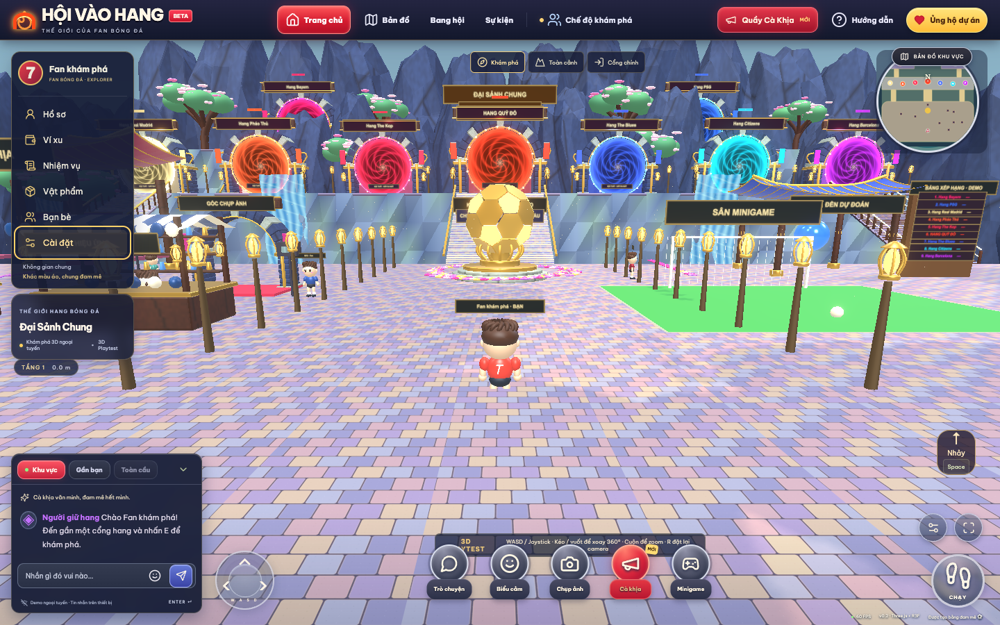
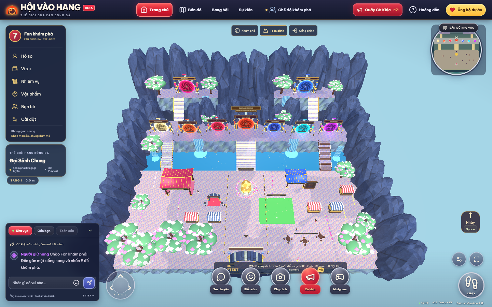
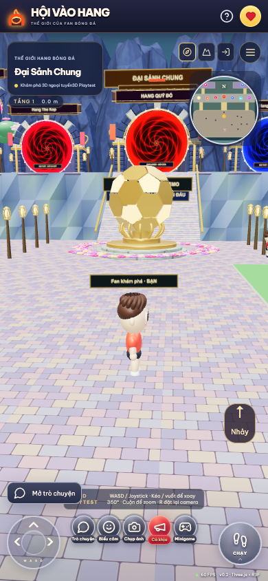

# Bàn giao Đại Sảnh Chung 3D — 05/11/2026

Bản nâng cấp đã triển khai trực tiếp trong repository. **Đã kiểm chứng nền tảng kỹ thuật và gameplay; chưa nghiệm thu đồ họa cinematic ngang ảnh concept.**

Mở bản chơi thử: http://localhost:5173/playtest . Chạy lại bằng `npm ci` rồi `npm run dev`.

## 1. Ảnh game thực tế

Các ảnh sau chụp từ Chromium/WebGL, không phải ảnh concept hoặc mockup React.

Ảnh bổ sung: [góc về cổng chính](grand-hall-qa/grand-hall-entrance.png), [đến cổng Bayern tầng 3](grand-hall-qa/grand-hall-bayern.png), [nội thất MU trong lượt kiểm tra](grand-hall-qa/grand-hall-mu-interior.png), [PNG tải trực tiếp từ chế độ chụp ảnh](grand-hall-qa/grand-hall-photo-mode.png).

## 2. Quy hoạch và chín cổng

Dữ liệu `packages/shared/grandHall.ts` là nguồn chuẩn cho cao độ, đường đi, footprint và vị trí. Tầng quảng trường 0 m, đại lộ 7 m, hai sân núi cao 15 m. Có cầu thang trung tâm, cầu đá phía Tây, cầu gỗ phía Đông và hai lối lên tầng 3. Có thể đi bộ đến các cổng cao, không phải teleport lên núi.

| Cổng | Vị trí trong đại sảnh | Nội thất |
|---|---|---|
| Bayern Munich | Tầng 3, Tây Bắc | Sắp ra mắt |
| PSG | Tầng 3, Đông Bắc | Sắp ra mắt |
| Real Madrid | Tầng 2, ngoài cùng phía Tây | Sắp ra mắt |
| Arsenal / Pháo Thủ | Tầng 2, kế Real | Sắp ra mắt |
| Liverpool / The Kop | Tầng 2, phía Tây MU | Sắp ra mắt |
| Manchester United / Quỷ Đỏ | Tầng 2, trung tâm | Vào/ra được cảnh nội thất 3D |
| Chelsea / The Blues | Tầng 2, phía Đông MU | Sắp ra mắt |
| Manchester City / Citizens | Tầng 2, kế Chelsea | Sắp ra mắt |
| Barcelona | Tầng 2, ngoài cùng phía Đông | Sắp ra mắt |

Không có Hang Chung hoặc cửa bảo tàng ở đại sảnh. Hồ sơ fan trung lập cũ vẫn được giữ trong dữ liệu tài khoản. Các cập nhật nội thất MU/bảo tàng trong repository là phần riêng, không được dùng để tuyên bố tám hang còn lại đã có nội thất.

Ảnh tổng hợp mới và phần yêu cầu chữ có điểm khác nhau về tầng của các đội. Bản triển khai ưu tiên các mục 5/21/22 của master prompt: **Bayern/PSG cao nhất, Real/Barcelona ở tầng giữa**. Xem [quy hoạch chi tiết](grand-hall-layout.md).

## 3. Công trình và tương tác

| Khu | Trạng thái |
|---|---|
| Tượng bóng vàng | Model panel bóng và bệ 3D, ánh sáng/vật liệu, vườn hoa, collision |
| Đấu Trường Cà Khịa | Công trình, khán đài, NPC; gặp gỡ/chat/biểu cảm. Đấu đối kháng và lịch sự kiện trực tuyến chưa phát hành |
| Đền Dự Đoán | Công trình, quả cầu và lựa chọn dự đoán vui lưu cục bộ; không cược tiền/thu xu/phát thưởng |
| Phố cửa hàng | Năm quầy 3D có mái, cột, kệ và vật phẩm trưng bày; mở hệ thống ví/tài khoản hiện có. Không thêm database hoặc số dư giả |
| Sân Minigame | Khung thành/lưới 3D, bóng Rapier, chọn hướng/lực và sút thật; kiểm tra bóng vào khung thành. Điểm/lượt thử không quy đổi thành tiền |
| Góc Chụp Ảnh | Công trình, camera vật thể và thảm; đổi góc camera, điều chỉnh và tải PNG từ WebGL canvas; đã xác nhận file tải có dữ liệu |
| Khu Giao Lưu Fan | Bàn/ghế, NPC và chat/bong bóng. Ngồi đồng bộ tại bộ bàn ghế mới chưa mở như một tính năng hoàn chỉnh |
| Bảng Xếp Hạng | Danh sách chín hang, ghi Demo và dấu — khi chưa có nguồn điểm production; không lấy điểm/số online từ ảnh |

HUD React có sidebar, chat, minimap theo vị trí thật, thanh hành động, các góc camera và ba mức Low/Medium/High. Các mục chưa phát hành thông báo trạng thái, không tạo tiến trình, level hoặc số dư giả.

## 4. Model GLB và nguồn

Đã tích hợp **11 GLB nguyên bản**, xuất bằng Blender 4.3.2:

- `portal-grand.glb` — cổng đá ghép, vault có chiều dày, cột và trang trí.
- `cliff-sculpted.glb` — mesh vách núi có bề mặt/UV.
- `cherry-tree.glb` — thân/cành, lá và cánh hoa 3D.
- `lantern.glb` — lồng đèn phát sáng.
- `market-stall.glb` — quầy, mái vải, kệ và hàng trưng bày.
- `pavilion.glb` — mái cong, cột, nan và trang trí đình/đền.
- `golden-football.glb` — quả bóng nhiều panel và bệ.
- `bridge-stone.glb`, `bridge-wood.glb` — hai loại cầu dốc có cấu kiện thật.
- `fan-table.glb` — bàn và ghế.
- `fan-chibi.glb` — SkinnedMesh có armature và 10 clips: Idle, Walk, Run, Turn, Wave, Cheer, Laugh, Sad, Celebrate, Sit.

Các model được tạo bằng `scripts/models/build_assets.py`; không nhúng ảnh tham chiếu vào kiến trúc. Không lấy logo chính thức từ concept. [Manifest](../assets/models/manifest.json) ghi hash, dung lượng, số tam giác, texture và clip; [hồ sơ asset](asset-production-plan.md) mô tả phương pháp, quyền nguồn và tài nguyên còn thiếu.

## 5. Gameplay và backend

Three.js/R3F/Rapier được giữ làm engine. Địa hình, công trình, cầu, cầu thang và nhân vật đều có geometry độc lập. Chữ trên biển/tên dùng texture chữ riêng; mặt VFX portal/nước không thay thế mesh công trình.

Camera có xoay ngang liên tục 360°, ngẩng/cúi, zoom, góc toàn cảnh và góc về cổng chính. Nhân vật hỗ trợ WASD/phím mũi tên, chạy, joystick và kéo/vuốt camera. Capsule, collider vật cản, raycast camera và việc chuyển phòng được kiểm tra trong trình duyệt.

Socket.IO tiếp tục xác minh token/hồ sơ theo hệ thống hiện có. Server dùng layout chung để suy ra cao độ, chặn đường xuyên vách/khe trống, kiểm tra tốc độ và từ chối height giả. Snapshot có cao độ để hiển thị người chơi ở tầng trên. Không tạo cơ chế bỏ qua Auth trên server production.

Supabase Auth, wallet, ledger và giao dịch dùng module hiện có. Không tạo migration/database mới cho đại sảnh, không sửa số xu ở frontend và không thực hiện thanh toán thật.

## 6. FPS đã đo

Nguồn đầy đủ: [grand-hall-performance.json](grand-hall-qa/grand-hall-performance.json). Phép đo được ghi trong lượt Chromium trên **Apple M4, macOS arm64, ANGLE Metal Apple M4** ngày 05/11/2026; đây là mẫu ngắn tại các góc thử, không phải benchmark toàn bộ bản đồ hoặc tải đông người. Bảng dưới là lượt kiểm tra cuối. [Lượt trước](grand-hall-qa/performance-initial.json) có mẫu Desktop Medium thấp nhất 35 FPS; vì vậy không coi trung vị 60 là cam kết FPS luôn ổn định.

| Chế độ | Viewport | FPS trong mẫu |
|---|---|---|
| Desktop Medium | 1440 × 900 | 60–61, trung vị 60 |
| Desktop High | 1440 × 900 | 60, trung vị 60 |
| Mobile Low, giả lập trên M4 | 390 × 844 | 60, trung vị 60 |

**Chưa đo điện thoại thật, Safari iPhone hoặc Android Chrome trên phần cứng đích.** Không coi kết quả giả lập là bằng chứng hiệu năng mobile thật.

## 7. Kết quả kiểm tra đã ghi nhận

Bổ sung hồi quy lỗi trang trống: `npm run test:playtest-offline` **1/1**. Test chạy Vite dev với các biến cấu hình Supabase rỗng, kiểm tra lần mở đầu và reload, nhân vật đi được, không có lỗi JavaScript và không tự mở kết nối Socket.IO thiếu token. Lỗi gốc là đọc `socket.auth.accessToken` khi `socket.auth` chưa được khởi tạo; đã khởi tạo object và bảo vệ phép đọc.

- `npm test`: **25/25**, gồm quy hoạch/đường liên tục đến chín hang, tương thích tọa độ/collider, server/socket, token giả và hồi quy RLS/ví/giao dịch bằng fixture/PGlite.
- `npm run test:e2e -- --grep-invert 'MU 3D'`: **5/5** trong lượt kiểm tra riêng Đại Sảnh: di chuyển/collision, orbit/zoom, lên tầng 2/3, tới Bayern/PSG/Real/Barcelona/MU, vào MU/trở lại, cầu, minimap, minigame, mobile, multiplayer/chat, ví và các góc QA.
- Kiểm tra thêm tải ảnh trong E2E cầu/minigame/photo: **1/1**, chờ download thật và kiểm tra dung lượng PNG.
- `npm run test:auth`: **13/13** ở lượt kiểm thử Auth trước đó trên fixture: nhiều kích thước màn hình, đăng ký/đăng nhập/khách, hồ sơ/reload, ví, chặn hành động thanh toán chưa cấu hình, khôi phục và thông báo OAuth.
- `npm run validate:assets`: **11/11 GLB**, không có số không hữu hạn, kiểm tra skin và đủ clip yêu cầu.
- `npm run build`: thành công web/server; Vite còn cảnh báo chunk physics khoảng 2,26 MB trước gzip.

Các kết quả Auth/ví là kiểm tra contract với fixture và cơ sở dữ liệu kiểm thử; không thay thế kiểm chứng OAuth, email hoặc thanh toán thật trên Supabase production. E2E Đại Sảnh dùng build/port/thư mục ảnh riêng để không phụ thuộc hot reload của phiên phát triển. Năm kịch bản này không bao gồm các test `MU 3D` dành cho bảo tàng mở rộng đang được cập nhật ở cùng repository. Lượt chạy toàn bộ trước đó có một test bảo tàng bị collision chặn trên tuyến đi về; kết quả 5/5 ở đây không phải tuyên bố toàn bộ suite bảo tàng đã đạt.

## 8. Sai khác lớn còn tồn tại so với concept

Bản này **chưa đạt nghiệm thu cinematic**. Các sai khác chính:

1. Chín hang đang dùng chung kit kiến trúc, khác màu/vị trí/nhận diện; chưa có chín silhouette được tạo riêng.
2. Địa hình và đường đi còn thẳng/đều; cần thêm art pass cho đá, nền, normal/roughness maps, cảnh quan xa và lối vườn hữu cơ.
3. Mật độ cây/hoa, khán giả, đồ nội thất và chi tiết trang trí thấp hơn ảnh.
4. Nhân vật đã có rig/animation, nhưng chưa đạt sculpt, skinning mềm và biểu cảm khuôn mặt của model mỹ thuật trong ảnh.
5. Nước cần thêm foam/mist/reflection và âm thanh có nguồn quyền; chưa có model đài phun nước phun tia hoàn chỉnh.
6. Tám nội thất, PvP/sự kiện trực tuyến, dữ liệu trận đấu/xếp hạng thật và tối ưu LOD/KTX2 cho điện thoại còn chưa hoàn tất.

Danh sách sản xuất tiếp: [asset-production-plan.md](asset-production-plan.md). Các ảnh đi kèm phản ánh đúng mức đồ họa hiện tại, không dùng để tuyên bố đã sao chép chính xác concept.
